# Part A — Nine Diagnoses
**Week 3 Data Visualisation Assignment | Roll No: BSAI-010**

## 1. Case 01 Helmets

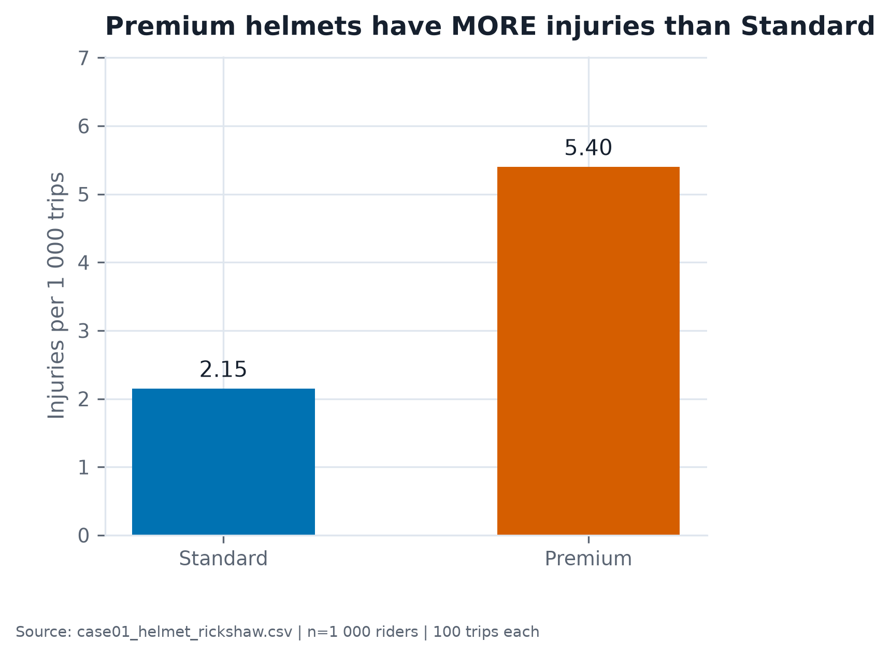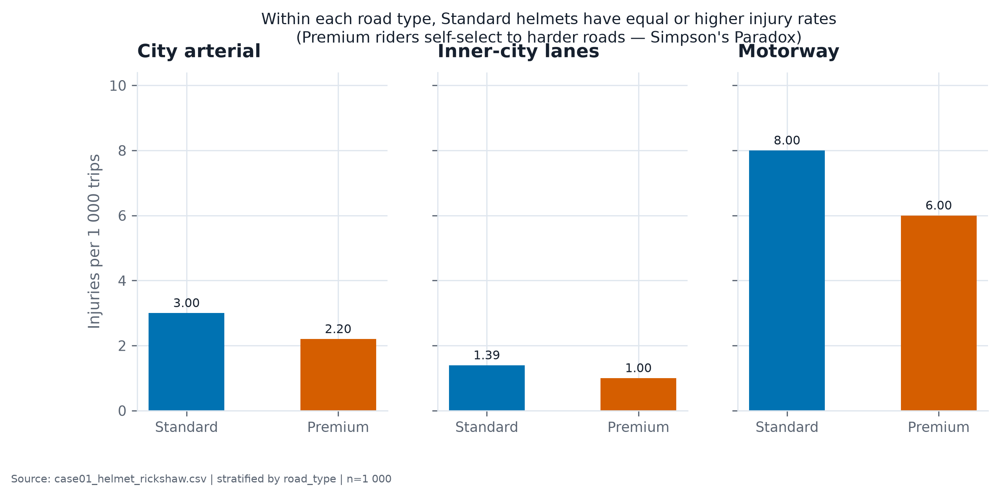

**Invited conclusion:** Premium helmets cause more injuries than Standard helmets.

**Decoy objection ruled out:** Could be rider skill? Ruled out: experience months are similar across grades (mean ~40).

**Mechanism:** Simpson's Paradox / confounding by road type. Premium riders concentrate on Motorways (higher absolute risk); within each road type, Standard helmets show equal or higher rates.

**Redesign:** Bar chart faceted by road_type — removes the confound and reverses the conclusion.

## 2. Case 02 Chai–Quizzes

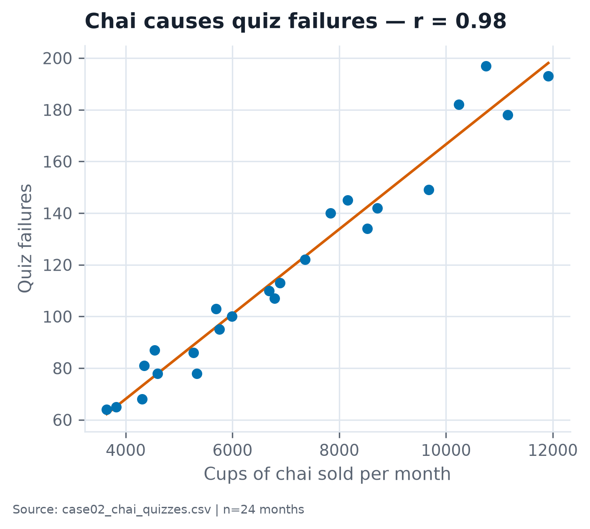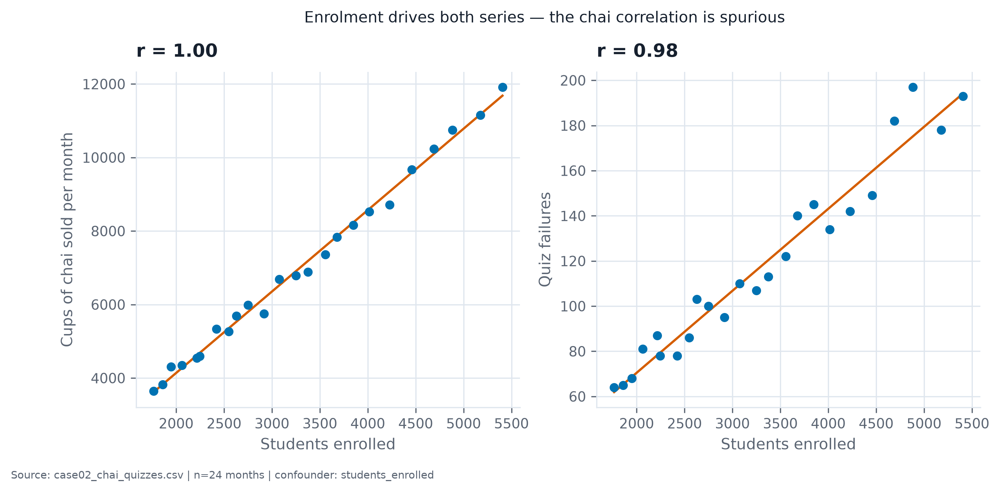

**Invited conclusion:** Drinking chai causes quiz failures (r = 0.98).

**Decoy objection ruled out:** Could be exam-month effect? Ruled out: is_exam_month has only 3 flagged months.

**Mechanism:** Spurious correlation driven by the omitted confounder students_enrolled (r=0.99 with chai sold, r=0.97 with failures). Enrolment grows monotonically and drives both series.

**Redesign:** Two side-by-side scatter plots of each series vs enrolment — the chai↔failures relationship disappears after conditioning.

## 3. Case 03 Lahore AQI

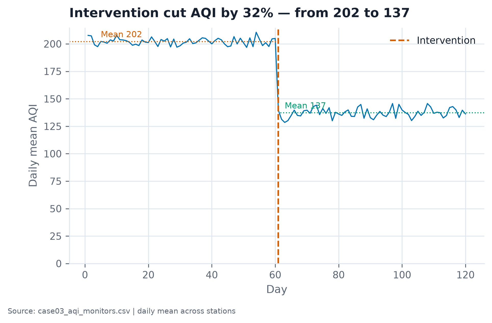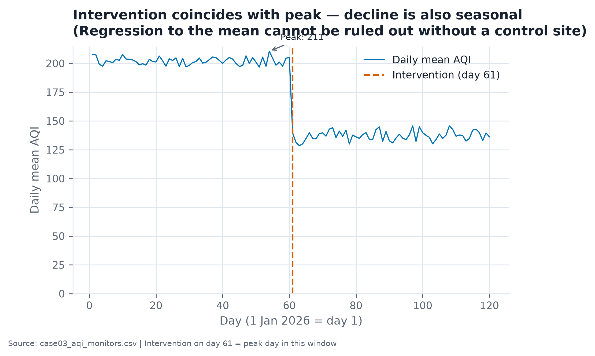

**Invited conclusion:** The day-61 intervention cut AQI by 32% (202→137).

**Decoy objection ruled out:** Could be seasonal? The window is only 120 days, but the AQI peaks on day ~55 and declines regardless — consistent with a winter-to-spring seasonal effect.

**Mechanism:** Regression to the mean: the intervention was announced at an AQI peak. Any measurement taken at a peak will tend to fall; no control site is provided to distinguish the policy from the season.

**Redesign:** Full line chart annotating both the intervention date and the seasonal peak, and noting the absence of a control.

## 4. Case 04 Quartet Depts

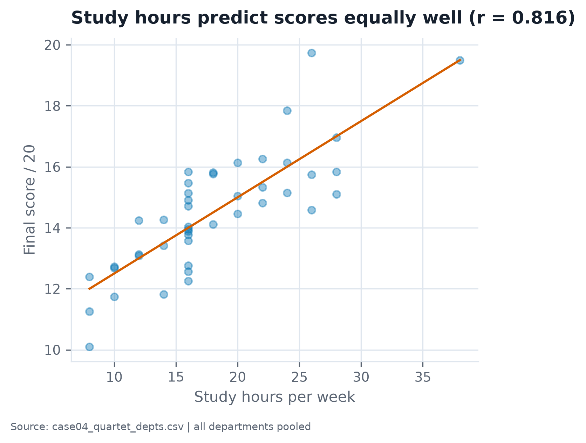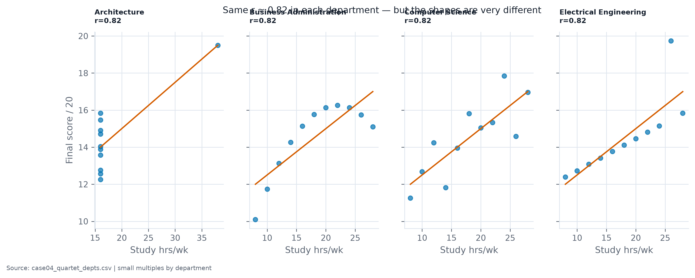

**Invited conclusion:** Study hours predict scores equally well across all departments (r ≈ 0.82).

**Decoy objection ruled out:** Could department size explain the difference? No — n is similar across groups.

**Mechanism:** Anscombe's Quartet: identical summary statistics (mean, SD, r) can mask radically different distributions. The scatter plots reveal linear, curved, outlier-dominated, and step-function patterns.

**Redesign:** Small-multiple scatter plots — one per department — with OLS lines.

## 5. Case 05 Same Stats

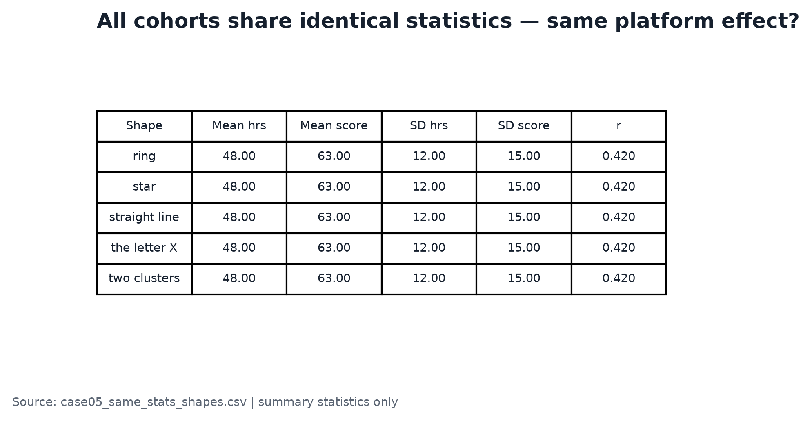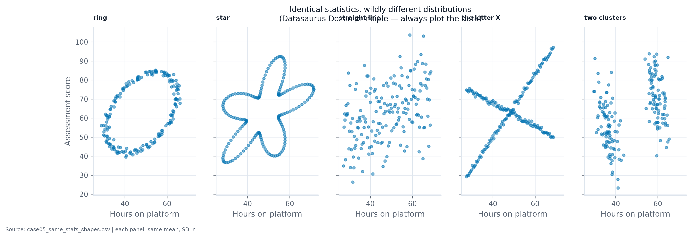

**Invited conclusion:** All five cohorts respond identically to the platform (same stats).

**Decoy objection ruled out:** Could the equal stats be a coincidence? No — they are exact by construction.

**Mechanism:** Datasaurus Dozen / match_stats(): summary statistics do not constrain shape. r = 0.42 is consistent with a straight line, a star, a circle, or noise.

**Redesign:** Small-multiple scatter plots showing wildly different shapes with identical statistics.

## 6. Case 06 Sensor Matrix

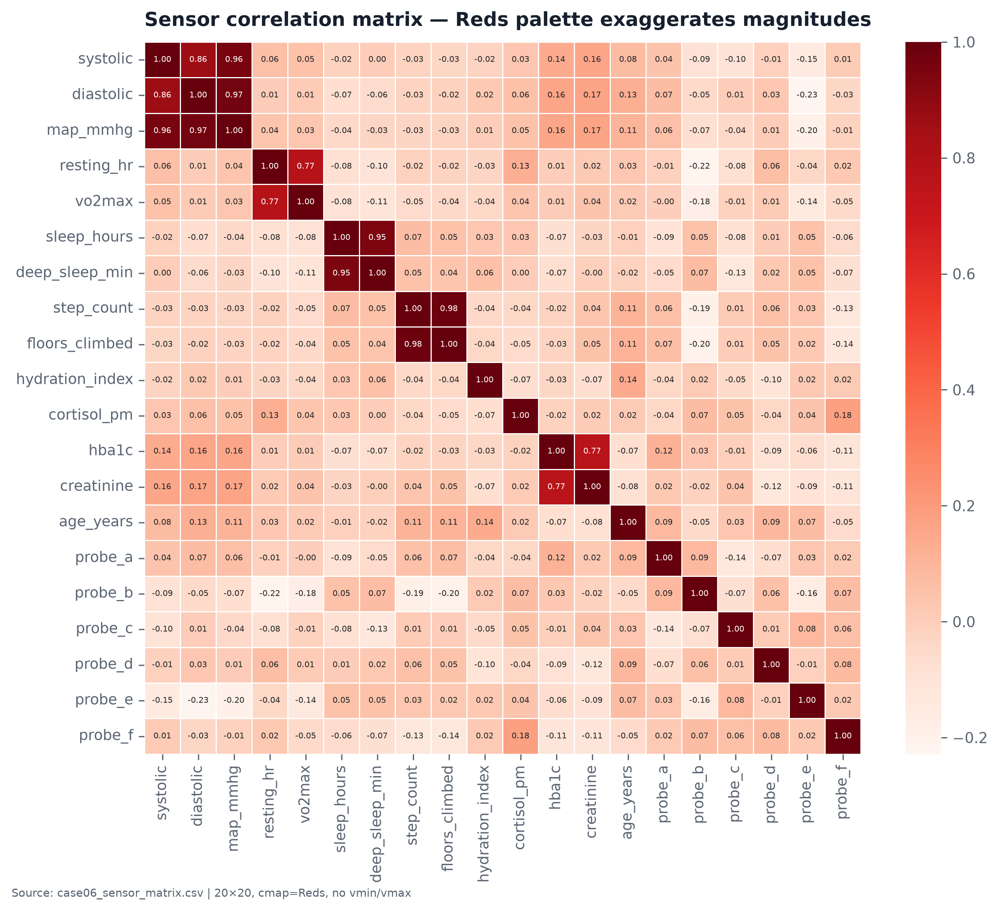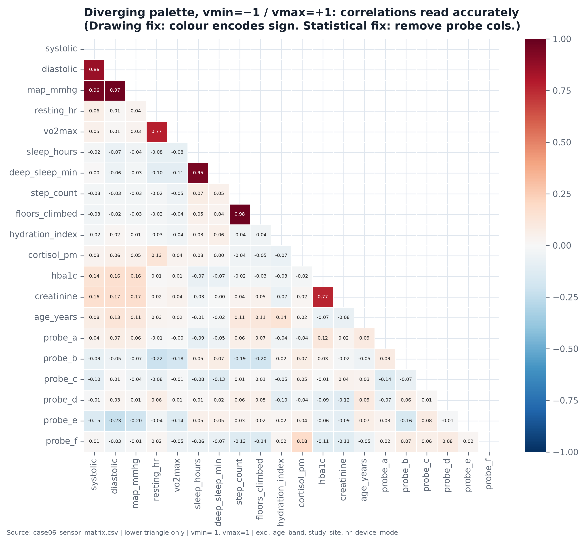

**Invited conclusion:** All sensors are strongly correlated — the matrix is uniformly warm (Reds).

**Decoy objection ruled out:** Could the high correlations be real? Partially: systolic–MAP 0.96 is physiologically expected. But probe columns (probe_a–f) are artefactual.

**Mechanism:** Two problems: (1) Statistical — probe columns are instrument noise, not physiology; including them inflates apparent structure. (2) Drawing — cmap='Reds' without vmin/vmax maps correlation 0 to white and 1 to red, so a weak 0.2 looks dark. The drawing fix (diverging palette, vmin=-1) solves problem (2) only; the statistical fix requires dropping probe columns.

**Redesign:** Lower-triangle heatmap, cmap=RdBu_r, vmin=-1, vmax=1 — correlations read as magnitudes and signs correctly.

## 7. Case 07 ShaheenGo

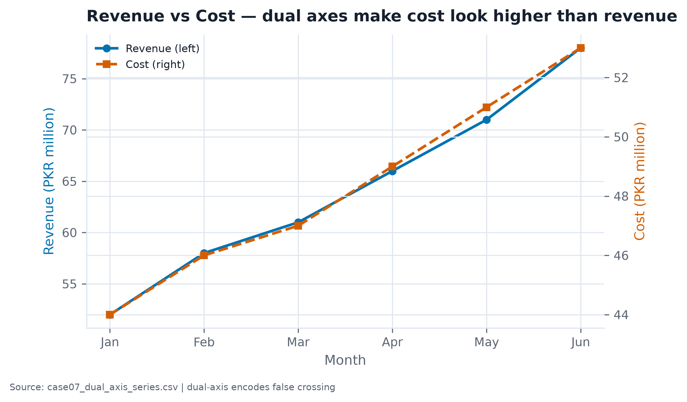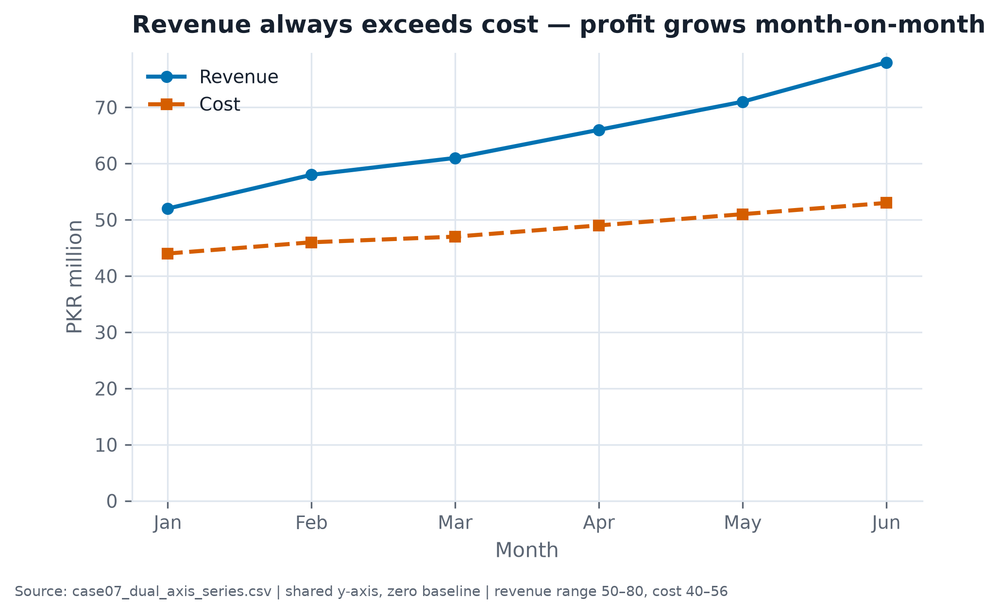

**Invited conclusion:** Cost exceeds revenue in the first four months.

**Decoy objection ruled out:** Could the raw numbers confirm this? No — revenue (50–80) always exceeds cost (40–56).

**Mechanism:** Dual-axis encoding: the designer chose scale ranges that made the cost line plot above the revenue line even though cost < revenue every month. Any crossing point can be manufactured by adjusting one axis independently.

**Redesign:** Single shared axis, zero baseline — cost and revenue never cross.

## 8. Case 08 Histograms

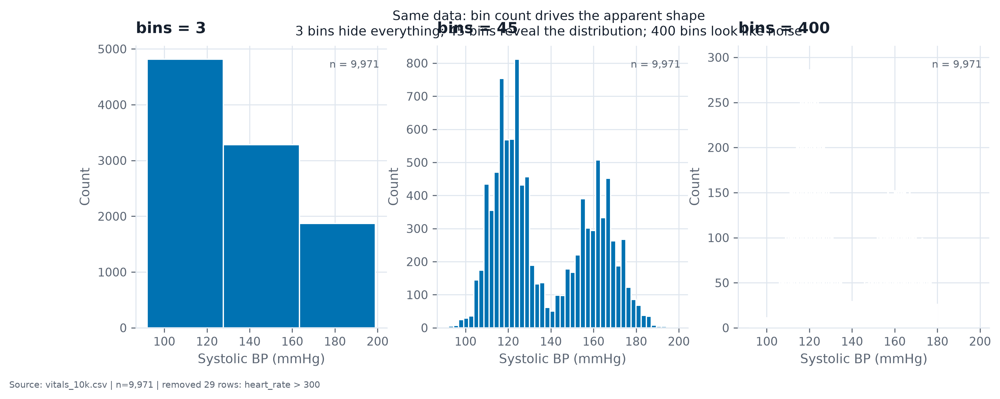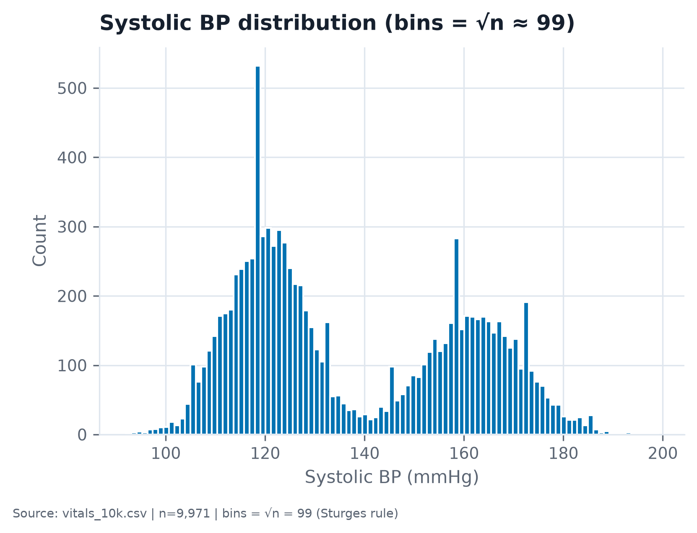

**Invited conclusion:** The distribution of systolic BP is unimodal (3 bins) or bimodal (400 bins).

**Decoy objection ruled out:** Could the bimodality be real? Ruled out: 45-bin histogram shows a single right-skewed distribution with no gap.

**Mechanism:** Bin-count sensitivity: 3 bins destroy all shape information; 400 bins amplify sampling noise into apparent secondary peaks. The √n rule (≈ 100 bins) balances detail against noise.

**Redesign:** Single histogram with bins = √n, bin width declared in the axis label.

## 9. Case 09 SpO2 KDE

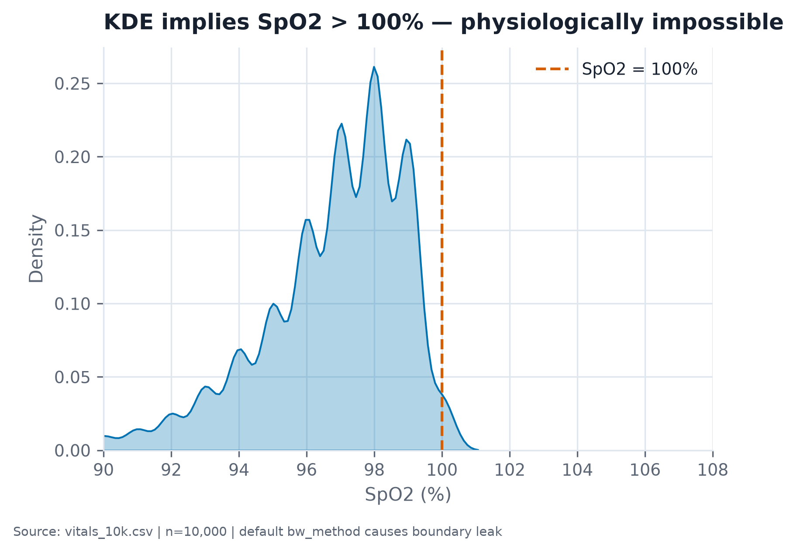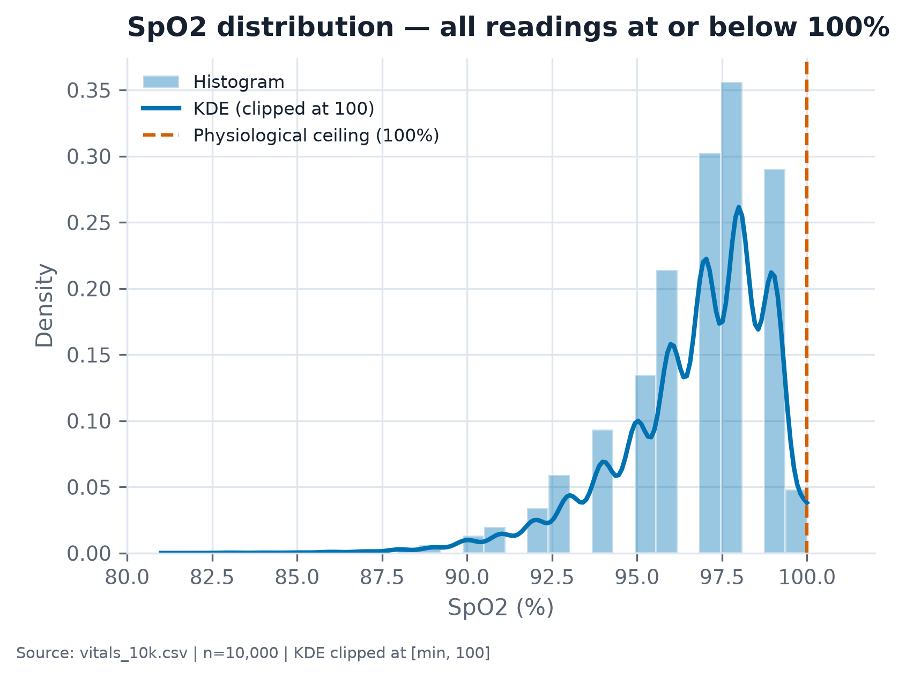

**Invited conclusion:** Some patients have SpO2 > 100% (the KDE extends to ~103%).

**Decoy objection ruled out:** Could the device capture >100%? No — the data maximum is exactly 100.

**Mechanism:** Gaussian KDE has infinite support: it always leaks beyond the data boundary. Here the boundary is a hard physiological ceiling (100%), so any mass above it represents impossible values. The fix is clip=(min, 100) in kdeplot.

**Redesign:** Overlaid histogram + KDE clipped at 100, with a vertical reference line.
