# Part A -- Nine Diagnoses
**Week 4 Data Visualisation Assignment | Roll No: BSAI-010**

## 1. Case 01 Orders String-Date

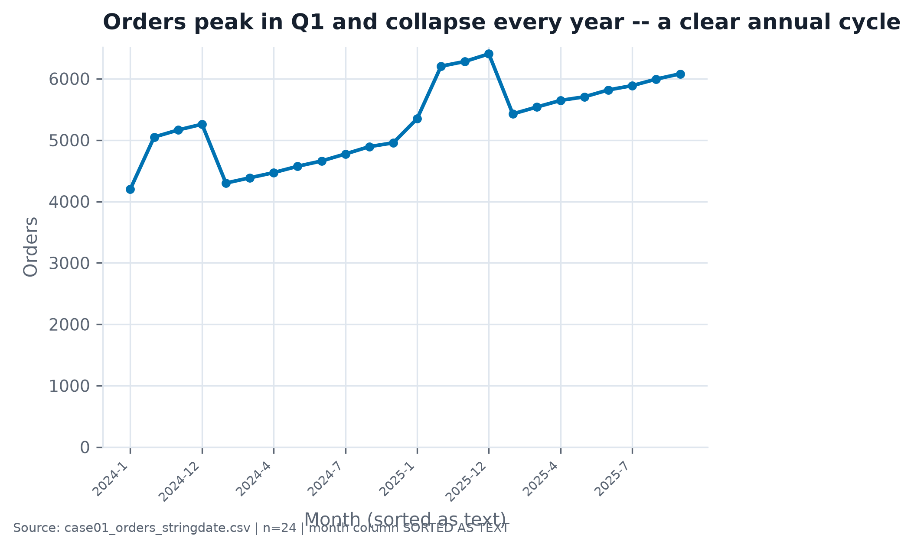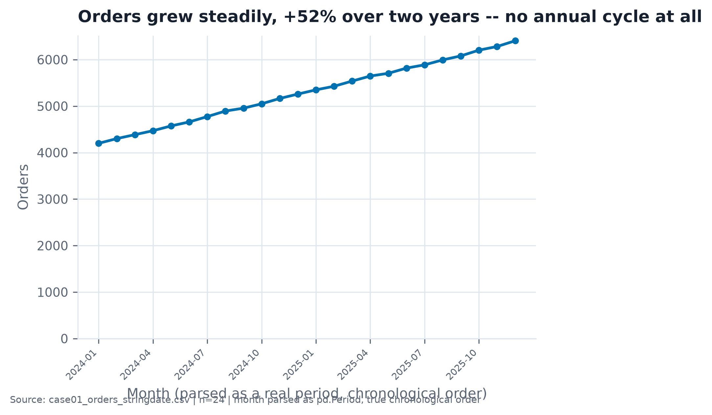

**Invited conclusion:** Orders peak in Q1 and collapse every year -- a clear annual cycle.

**Decoy objection ruled out:** Could the sample be too small? No -- n=24, a full two years of monthly data; the issue is order, not size.

**Mechanism:** The month column is text ('2024-1', '2024-10', ...) with no zero-padding. Sorting it as a STRING is not chronological: '2024-10' < '2024-2' lexicographically, so October, November and December sort before February. The series genuinely climbs monotonically; the two 'drops' (958 and 978) are artefacts of the resort, not business events.

**Redesign:** Parse the month as a pd.Period and sort chronologically -- orders rise steadily +52%, no cycle.

## 2. Case 02 Shop Closed

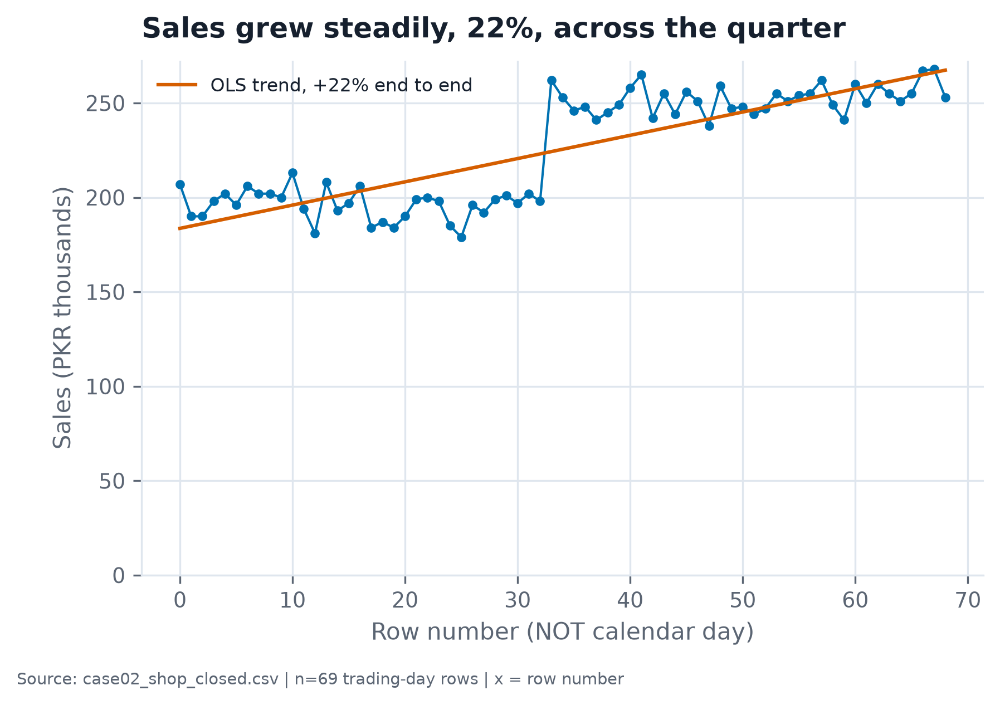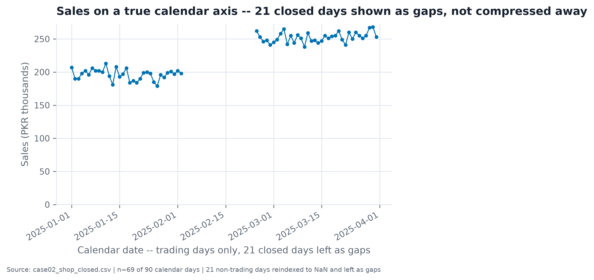

**Invited conclusion:** Sales grew steadily, 22%, across the quarter.

**Decoy objection ruled out:** Could the OLS line be overfit? No -- the trend is real; the issue is the x-axis, not the regression.

**Mechanism:** The file only records trading days (weekends excluded). Plotting against row number treats 69 consecutive rows as 69 consecutive days, silently compressing the real 90-day calendar span and erasing the weekend gaps -- a reader cannot see that Friday-to-Monday is one business day's gap on this axis but three calendar days.

**Redesign:** Reindex onto a full calendar and plot by true date, leaving closed days as gaps in the line.

## 3. Case 03 Bandwidth Levels

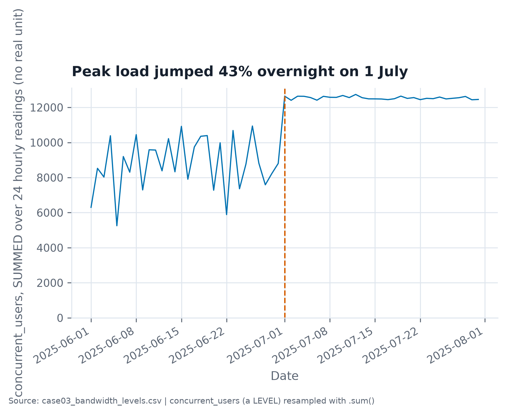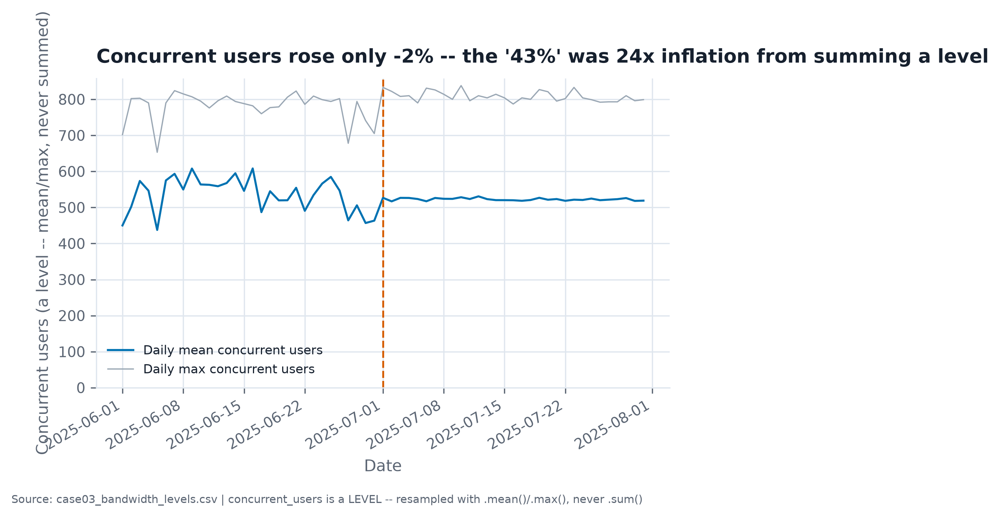

**Invited conclusion:** Peak load jumped 43% overnight on 1 July.

**Decoy objection ruled out:** Could July simply have more users? Real growth would show in the MEAN level too -- and it barely moves.

**Mechanism:** concurrent_users is a LEVEL (a snapshot of who is connected at that instant), not a flow. Resampling a level with .sum() adds up 24 unrelated snapshots per day, a number with no real-world meaning. The '43% jump' is sensitive to how many hours of already-elevated readings happen to fall in July vs June, not a step change in capacity.

**Redesign:** Resample the level with .mean() or .max(), never .sum() -- the true change is a few percent.

## 4. Case 04 Intervention Lag

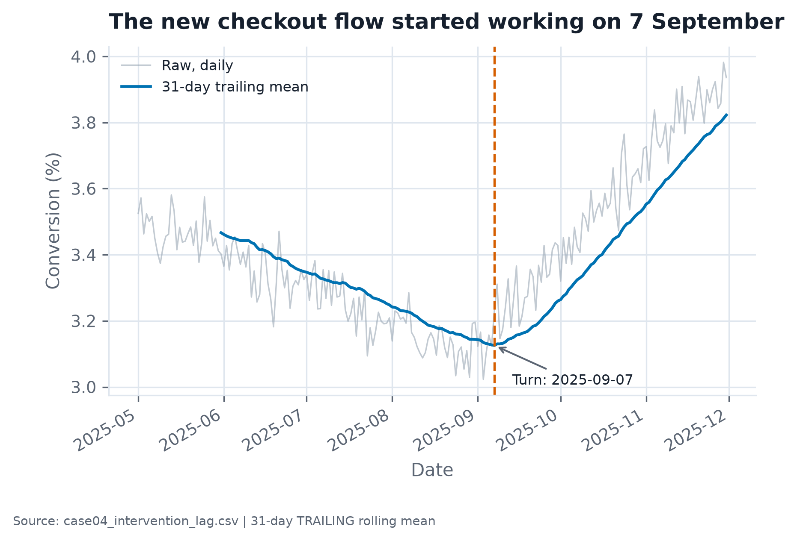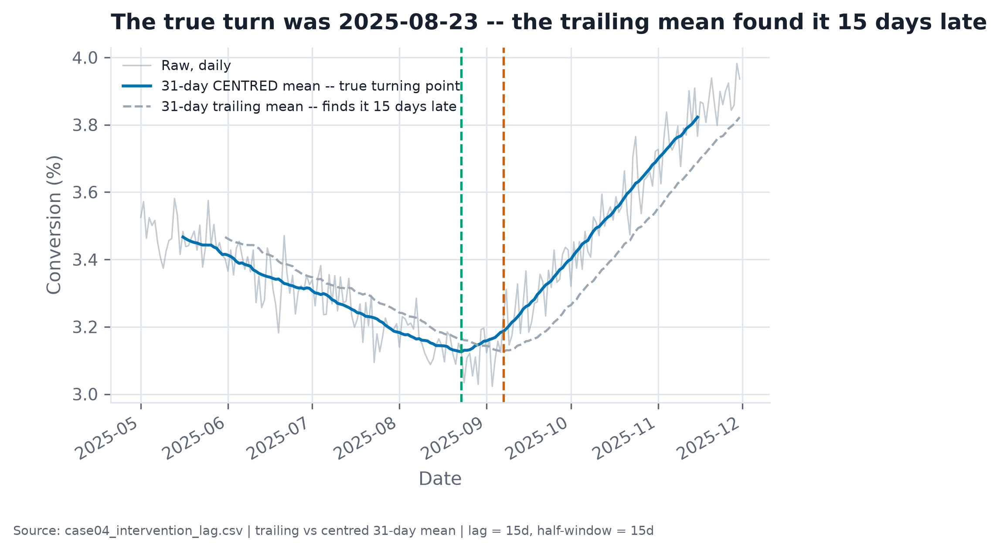

**Invited conclusion:** The new checkout flow started working on 7 September.

**Decoy objection ruled out:** Could the 31-day window be too long? No -- any trailing window has the same lag problem, just a different number of days late.

**Mechanism:** A trailing rolling mean at day t only knows about days t-30..t, so it cannot register a turn until the window has filled. lag_at_turn() shows the trailing mean finds the minimum roughly half a window (about 15 days) after the centred mean does -- the real turning point is in late August, not 7 September.

**Redesign:** A centred rolling mean locates the true turn; report both and state which a live dashboard can show.

## 5. Case 05 Revenue Window

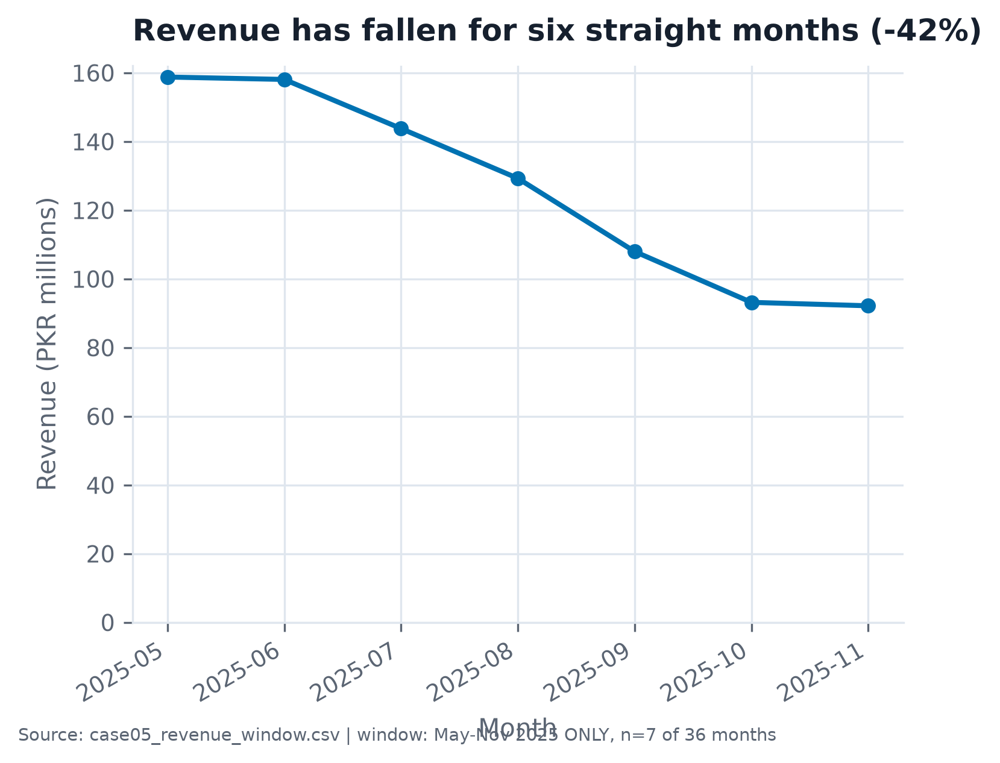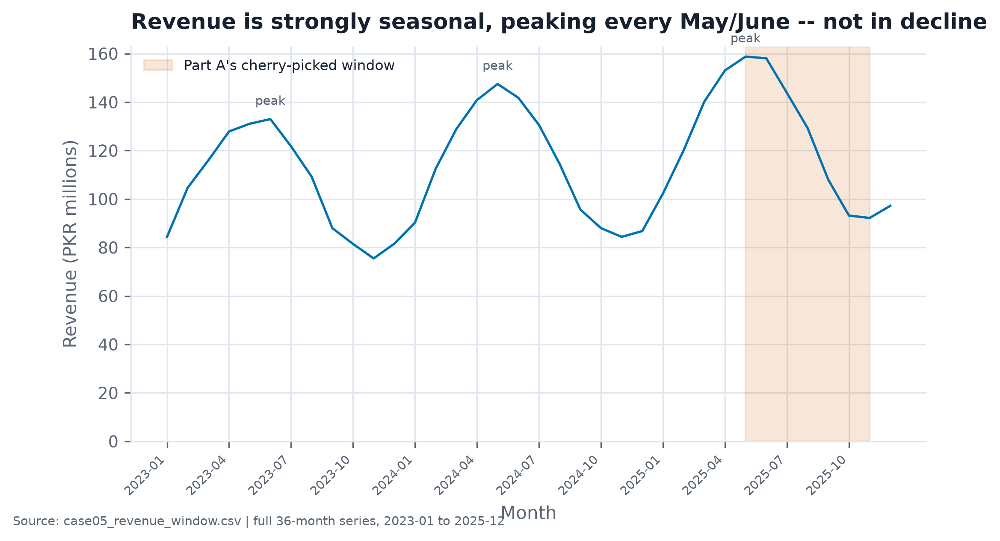

**Invited conclusion:** Revenue has fallen for six straight months.

**Decoy objection ruled out:** Is n=7 too small to trust? n is fine for describing those 7 months -- the problem is which 7 months were chosen, not how many.

**Mechanism:** The full 36-month series is strongly seasonal, peaking every May/June and troughing every November, repeated three times. May-to-November is exactly the down-leg of one cycle. The same '6 straight months of decline' claim could be made every single year on this series.

**Redesign:** Plot the full 36 months with the cherry-picked window and the three annual peaks marked.

## 6. Case 06 Monthly Partial

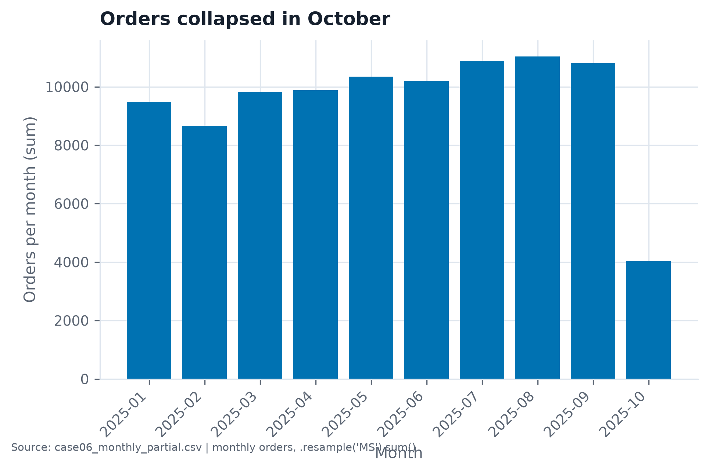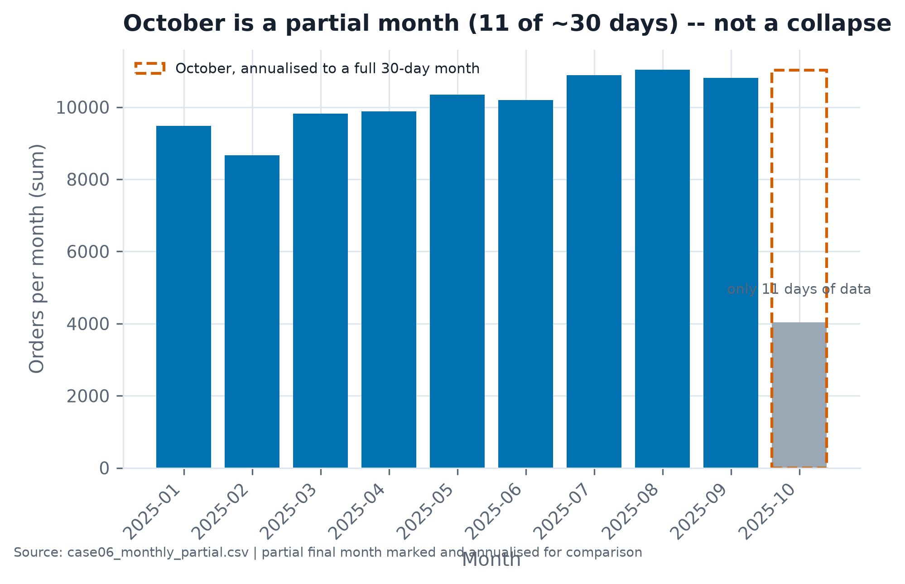

**Invited conclusion:** Orders collapsed in October.

**Decoy objection ruled out:** Could October genuinely be a weak month? The daily run-rate (orders per day) is actually in line with September once the shorter month is accounted for.

**Mechanism:** The extract was taken part-way through October, so the October bar sums far fewer days than every complete month before it. A partial period summed and drawn at the same visual weight as complete periods always looks like a collapse.

**Redesign:** Mark the partial month distinctly and show its run-rate annualised to a full month for comparison.

## 7. Case 07 Stacked Products

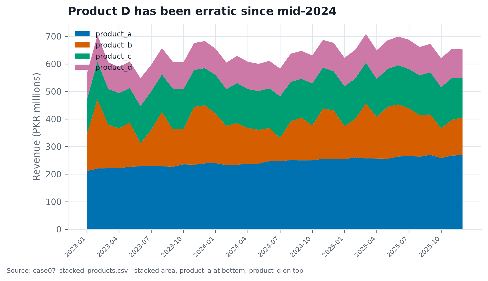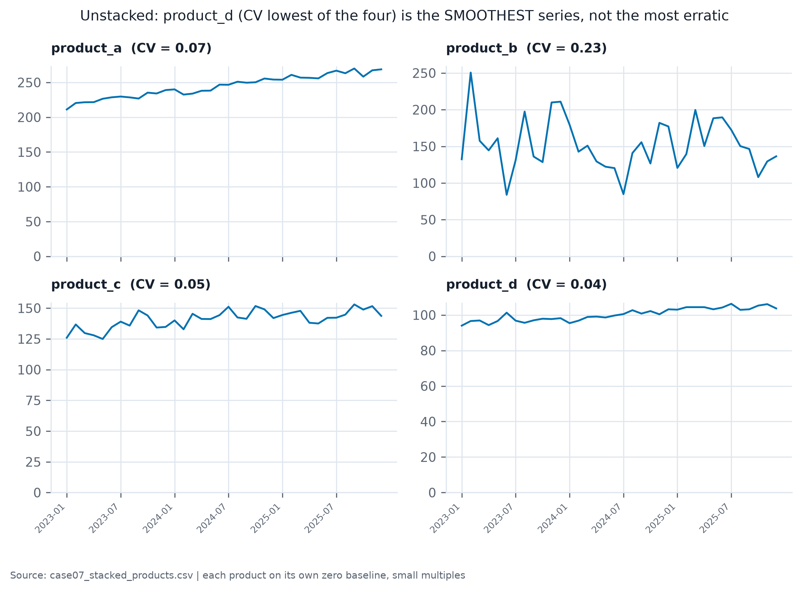

**Invited conclusion:** Product D has been erratic since mid-2024.

**Decoy objection ruled out:** Could product_d's own numbers be volatile? Its coefficient of variation is the LOWEST of the four products -- it is the smoothest, not the most erratic.

**Mechanism:** Volatility leaking upward through a stacked area's moving baseline. product_d is drawn on top of product_a+b+c, so its visible band wobbles whenever the series beneath it (chiefly the volatile product_b) wobbles, even though product_d's own value barely moves.

**Redesign:** Unstack into small multiples, each product on its own zero baseline -- product_d is visibly the calmest series.

## 8. Case 08 Channel Attribution

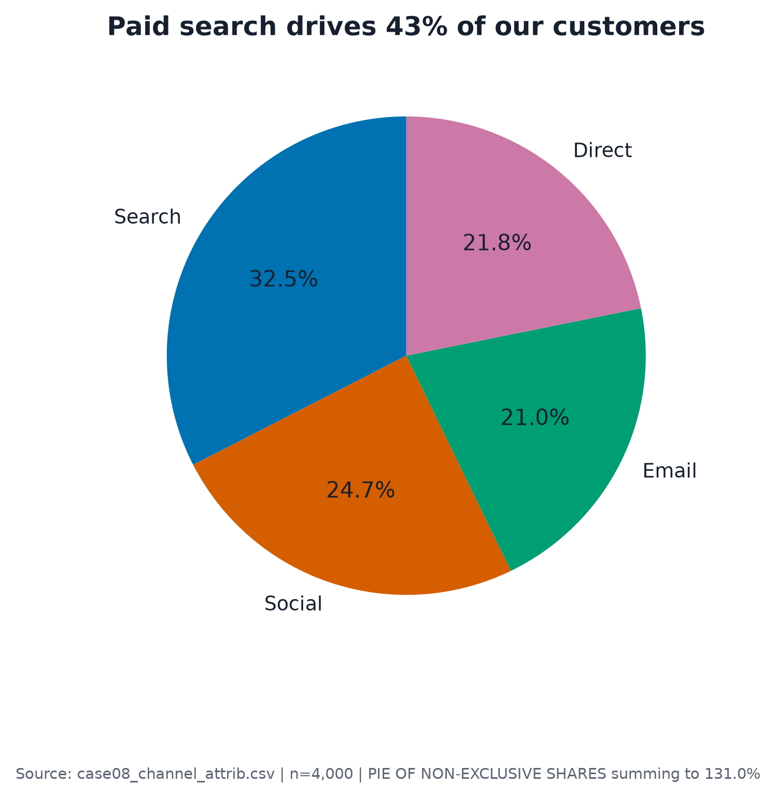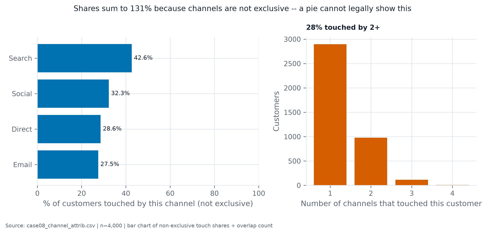

**Invited conclusion:** Paid search drives 43% of our customers.

**Decoy objection ruled out:** Could the 43% simply be rounded from a clean number? No -- the four shares sum to well over 100%, which is impossible for a true partition.

**Mechanism:** exclusivity_check() shows the four touch_* shares sum to over 130% and a large share of customers are touched by more than one channel before purchase -- the categories are not mutually exclusive, so a pie (or any part-to-whole chart) of them is not legal.

**Redesign:** A sorted bar chart of (non-exclusive) touch shares, plus a histogram of how many channels touched each customer.

## 9. Case 09 Premium Share

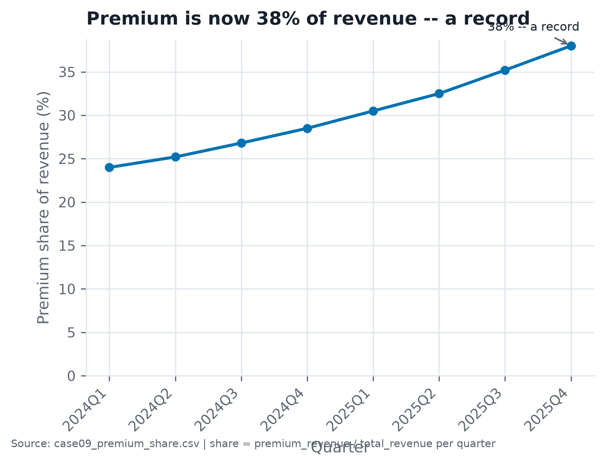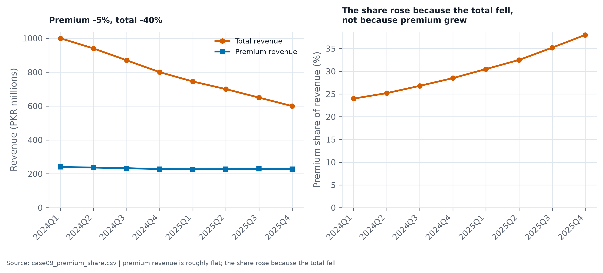

**Invited conclusion:** Premium is now 38% of revenue -- a record.

**Decoy objection ruled out:** Did premium revenue actually grow? It is essentially flat quarter to quarter (+240 to +228, even dipping) -- the growth is not there.

**Mechanism:** A rising share of a falling total. Premium revenue barely changes across the 8 quarters while total revenue nearly halves; the share rises mechanically as the denominator shrinks, not because the premium line is winning more business.

**Redesign:** Two series (premium and total revenue) plotted directly, beside the share -- showing the share rose for the wrong reason.
