# Part A -- Nine Diagnoses
**Week 5 Data Visualisation Assignment | Roll No: BSAI-010**

## 1. Case 01 Health Indicators (size)

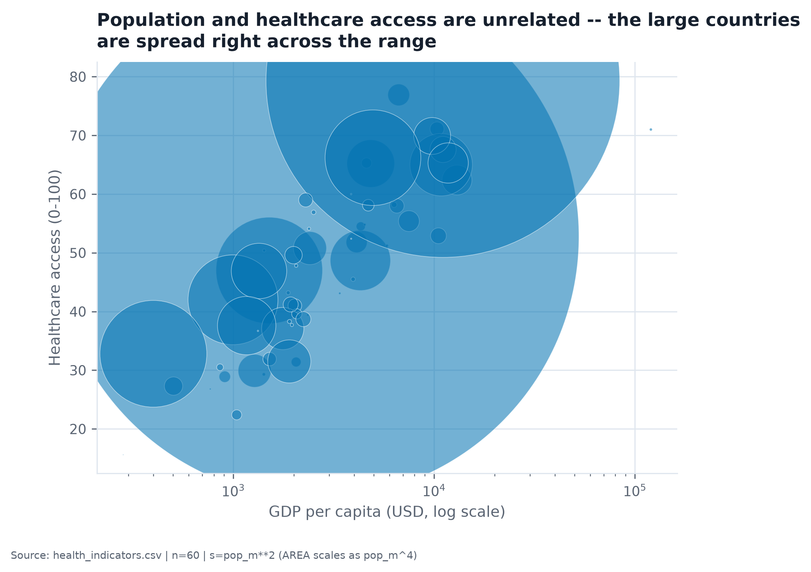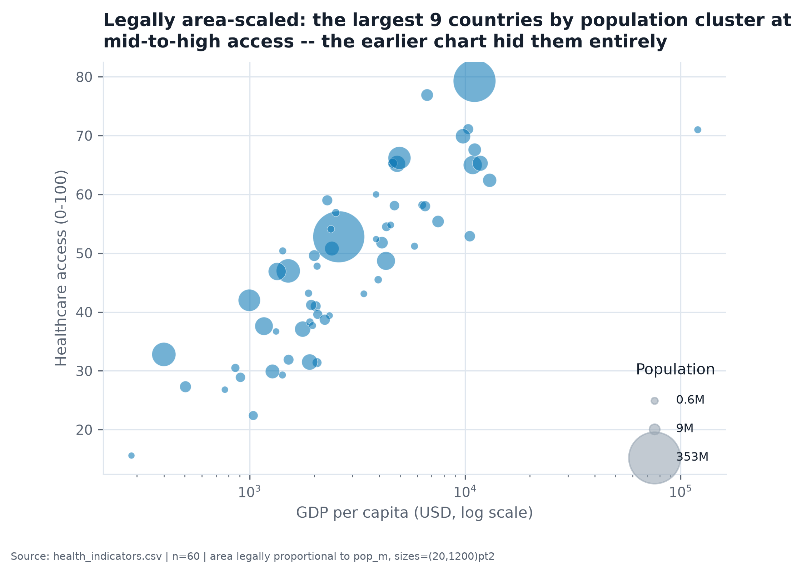

**Invited conclusion:** Population and healthcare access are unrelated -- the large countries are spread right across the range.

**Decoy objection ruled out:** Could the scatter just be noisy? No -- the real issue is that most large countries are not visible on the chart at all.

**Mechanism:** s=pop_m**2 is passed directly to matplotlib's `s`, which is already an AREA in points^2 -- so the mark's area scales as pop_m to the FOURTH power, not pop_m. The largest mark is 589x the area of the smallest, and 9 countries under 2.0M population are smaller than a single rendered point.

**Redesign:** Scale `s` so area is linearly proportional to pop_m, with a stated size range and a 3-value legend.

## 2. Case 02 District Health (raw count map)

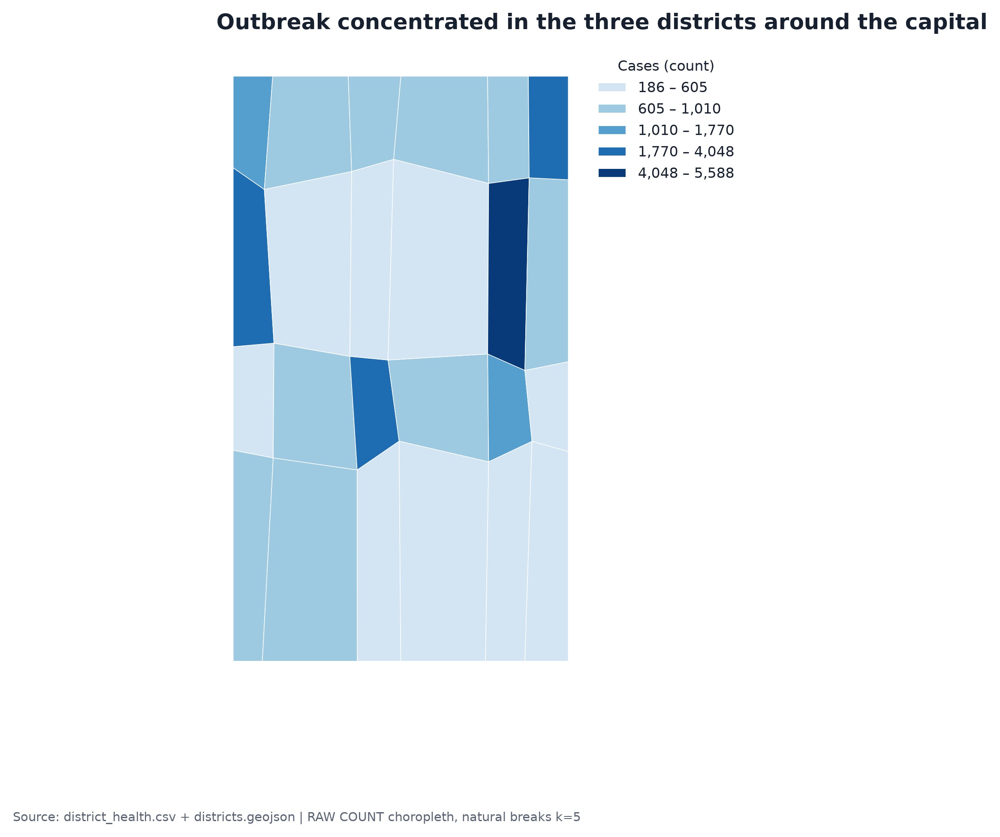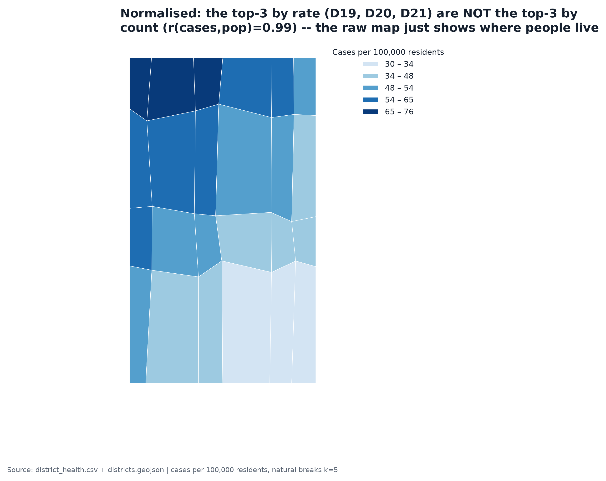

**Invited conclusion:** The outbreak is concentrated in the three districts around the capital.

**Decoy objection ruled out:** Could the capital genuinely have worse health outcomes? The per-capita rate map shows a completely different top three.

**Mechanism:** A choropleth of the RAW CASE COUNT, with no denominator. r(cases, population) is very strong, so the map is really showing where people live, not disease risk.

**Redesign:** Normalise to cases per 100,000 residents before classifying or colouring.

## 3. Case 03 Health Indicators (PCP min-max)

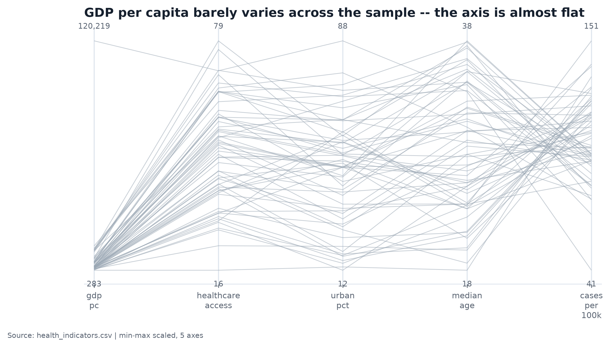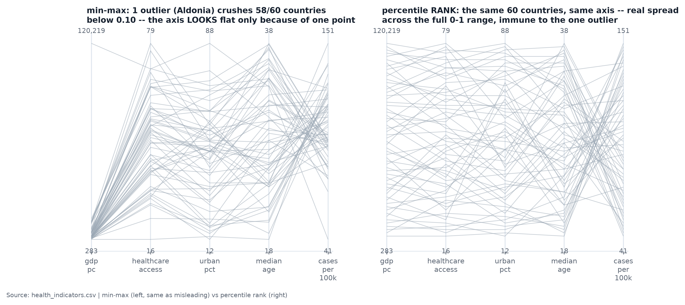

**Invited conclusion:** GDP per capita barely varies across the sample.

**Decoy objection ruled out:** Could GDP genuinely be uniform here? No -- it ranges from $283 to over $120,000, a huge real spread.

**Mechanism:** Min-max scaling maps the single $120,219 outlier to 1.0 and crushes every other country into the bottom 10% of the axis -- one extreme value flattens the whole picture.

**Redesign:** Percentile-rank scaling (immune to the outlier) shows the same 60 countries spread across the full axis.

## 4. Case 04 Health Indicators (PCP axis order)

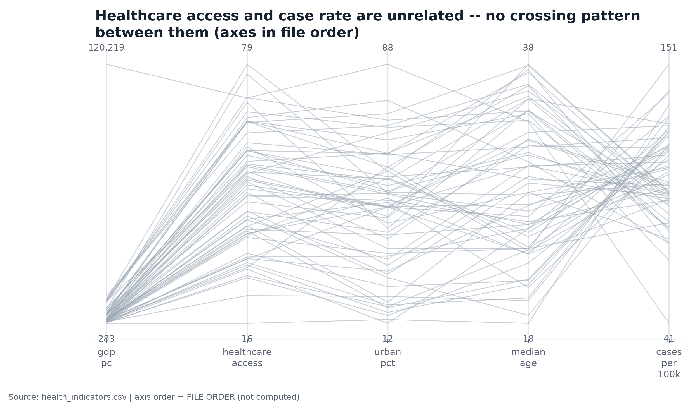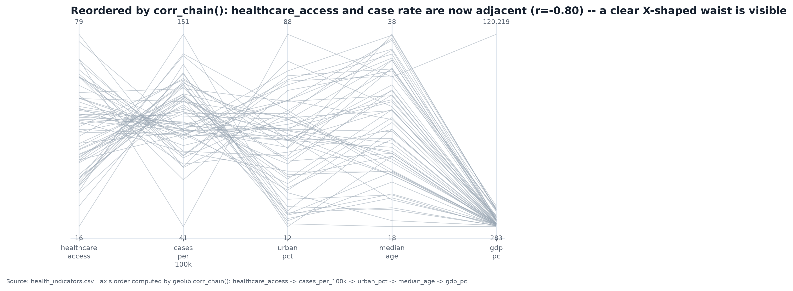

**Invited conclusion:** Healthcare access and case rate are unrelated -- no crossing pattern between them.

**Decoy objection ruled out:** Could the relationship genuinely be weak? No -- directly correlated, r is strongly negative once the two axes are placed next to each other.

**Mechanism:** The axes are left in FILE order, which happens to put two other columns between the two that are actually related -- a crossing pattern three axes apart is invisible by construction.

**Redesign:** geolib.corr_chain() places the two strongly-correlated axes adjacent, revealing the X-shaped waist.

## 5. Case 05 Flat Rates (quantile classes)

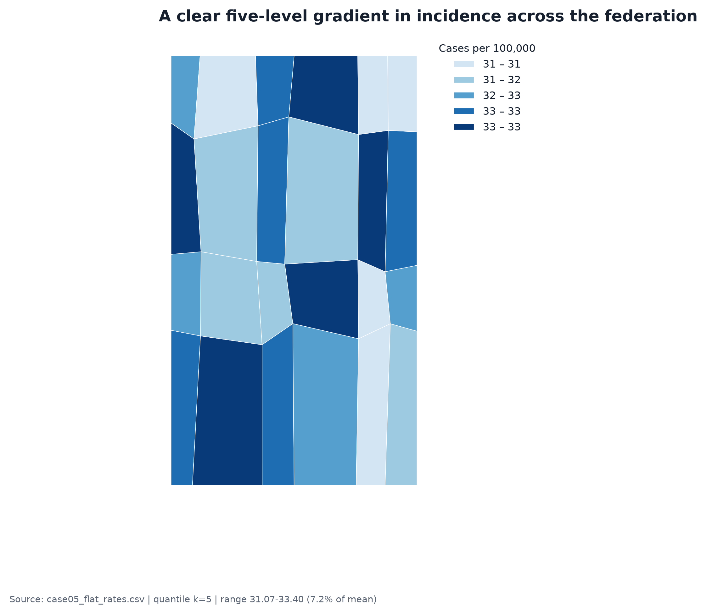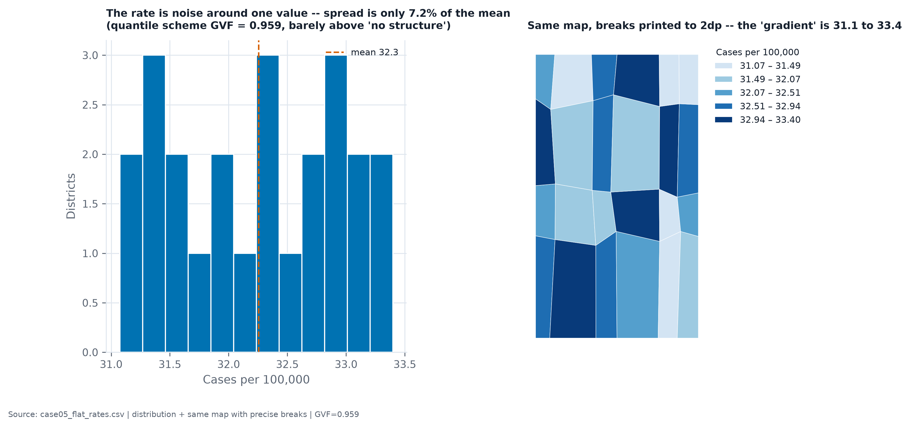

**Invited conclusion:** There is a clear five-level gradient in incidence across the federation.

**Decoy objection ruled out:** Could 5 classes be a reasonable choice regardless? Quantile classing ALWAYS produces 5 full classes, even from pure noise -- that is not evidence of structure.

**Mechanism:** The underlying rate spans only 7.2% of its own mean (31.07 to 33.40 per 100k) -- noise-level variation. Quantile classification forces this flat distribution into 5 equal-count bins regardless, manufacturing a gradient that is not there.

**Redesign:** A histogram showing the rate's true (flat) spread, plus the same map with breaks printed to 2dp.

## 6. Case 06 Small-Area Hotspot

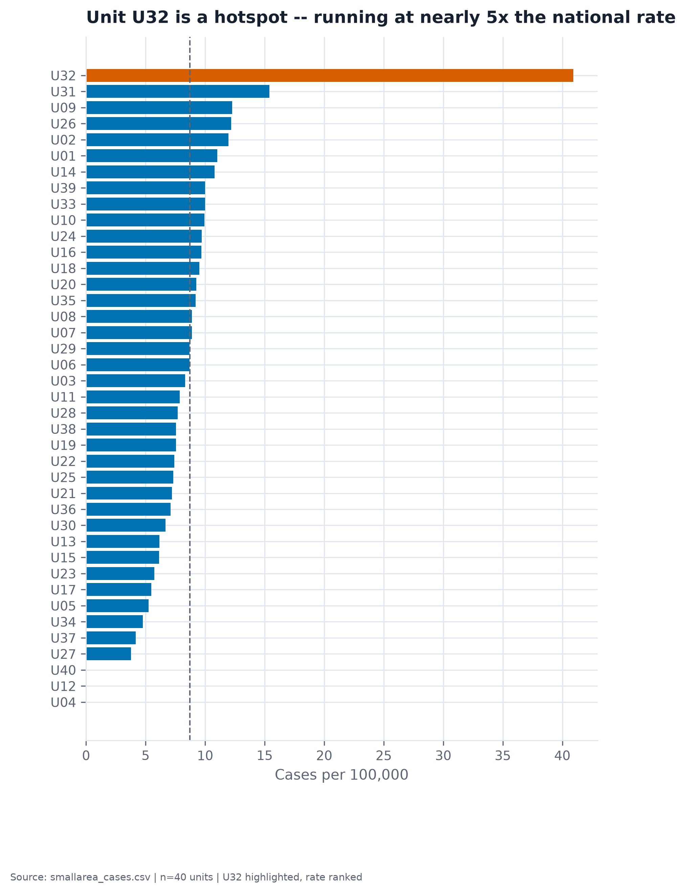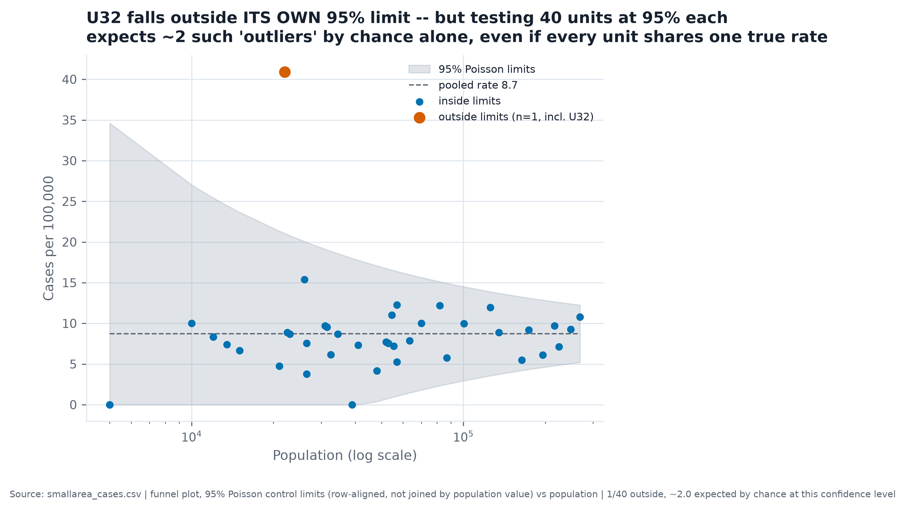

**Invited conclusion:** Unit U32 is a hotspot -- running at nearly five times the national rate.

**Decoy objection ruled out:** Could U32 genuinely be exceptional? Every unit with a large, stable population (>100k) falls in a narrow 5.5-12.0 band -- only tiny units swing wildly, and U32's own 9-case count is exactly the kind of small count a single bad month can produce.

**Mechanism:** U32's rate comes from just 9 cases in 22,000 people -- small-area Poisson noise. It does fall just outside ITS OWN 95% control limit, but the map ranks 40 such units at once: testing 40 independent units at 95% confidence EXPECTS about 2 false positives by chance alone, even if every unit shares one true underlying rate (which the generating process here does, by construction). One flagged unit out of 40 is within that expectation, not a confirmed hotspot.

**Redesign:** A funnel plot: rate against population with 95% Poisson limits, instead of a flat ranked bar chart -- showing the single flag in the context of 40 simultaneous tests.

## 7. Case 07 Income vs Rate

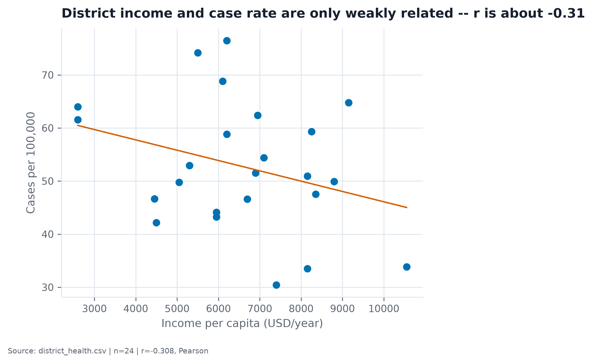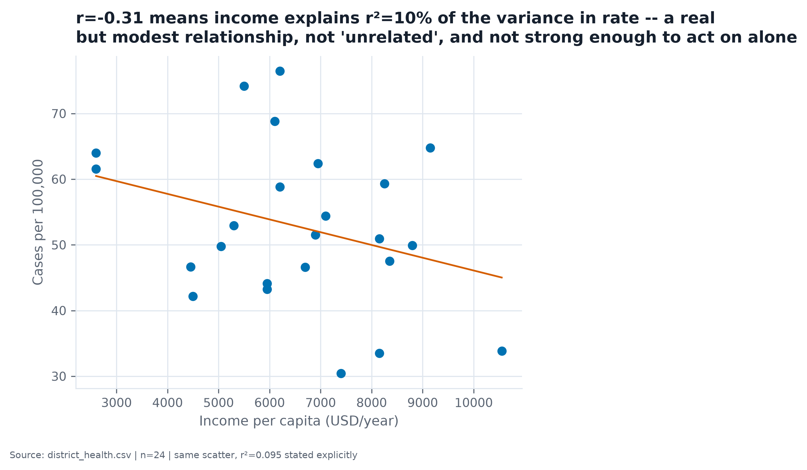

**Invited conclusion:** District income and case rate are only weakly related -- r is about -0.31.

**Decoy objection ruled out:** Is 'weakly related' actually the right reading of r=-0.31? It depends on what the number is used FOR -- r^2=0.09 means income alone is a poor predictor.

**Mechanism:** No drawing mechanism here -- the number is reported correctly. The chart simply never states what r=-0.31 (r^2=9%) actually means in plain terms, leaving 'weakly related' to carry more or less weight than the number supports depending on the reader.

**Redesign:** The same scatter, with r^2 stated explicitly so 'weak' has a number behind it.

## 8. Case 08 Rural Outbreak (map area)

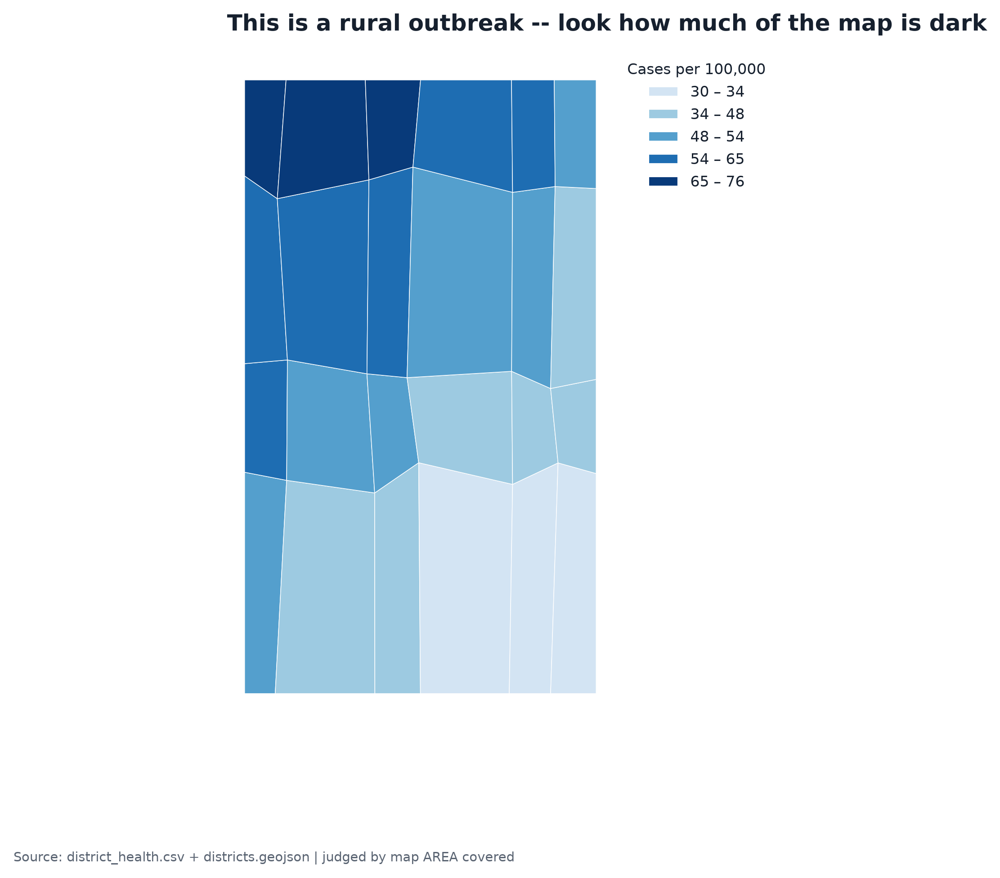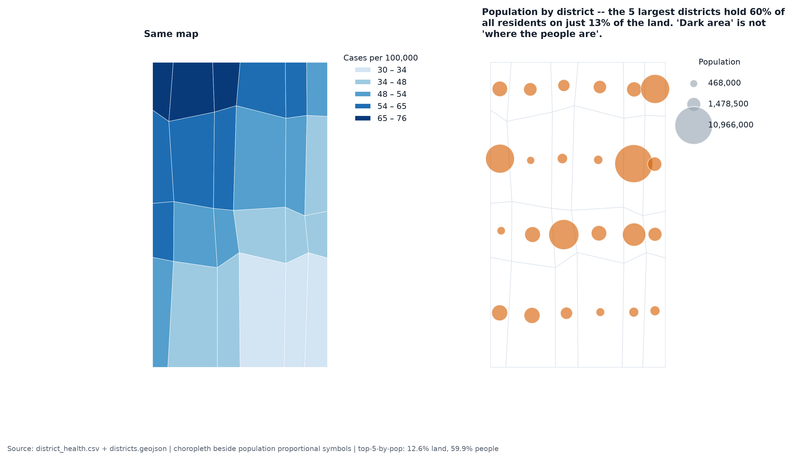

**Invited conclusion:** This is a rural outbreak -- look how much of the map is dark.

**Decoy objection ruled out:** Could the dark area genuinely represent most of the affected population? The 5 most populous districts are only 12.6% of the land but 59.9% of the people.

**Mechanism:** Judging a choropleth by the AREA it covers silently weights every square kilometre equally, but population (and therefore the true burden) is wildly uneven across the map -- a few small, dense districts matter far more than their map footprint suggests.

**Redesign:** The choropleth beside a population proportional-symbol map, so area-read and people-read are both visible.

## 9. Case 09 Region Profiles (radar area)

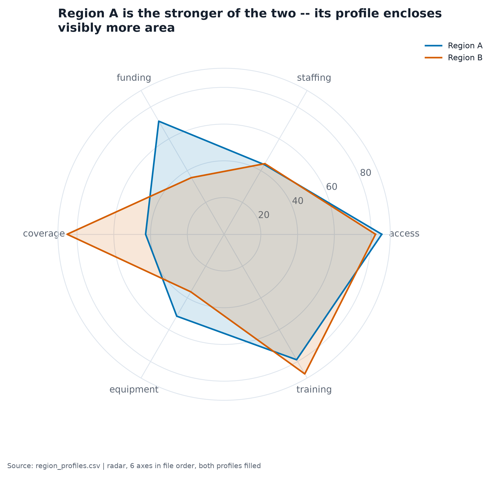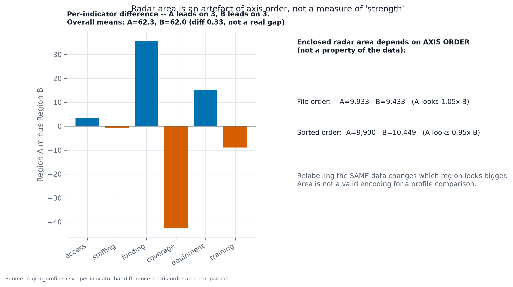

**Invited conclusion:** Region A is the stronger of the two -- its profile encloses visibly more area.

**Decoy objection ruled out:** Could area be a fair way to compare two profiles? Re-ordering the SAME six axes changes which region's polygon looks bigger -- area is not a property of the data at all.

**Mechanism:** A radar chart's enclosed area is a function of axis ORDER as much as the values themselves (the shoelace formula is order-dependent); the two regions' overall means are almost identical (62.3 vs 62.0), each leading on 3 of 6 indicators.

**Redesign:** A per-indicator difference bar chart -- the only fair, order-independent comparison of the two profiles.
